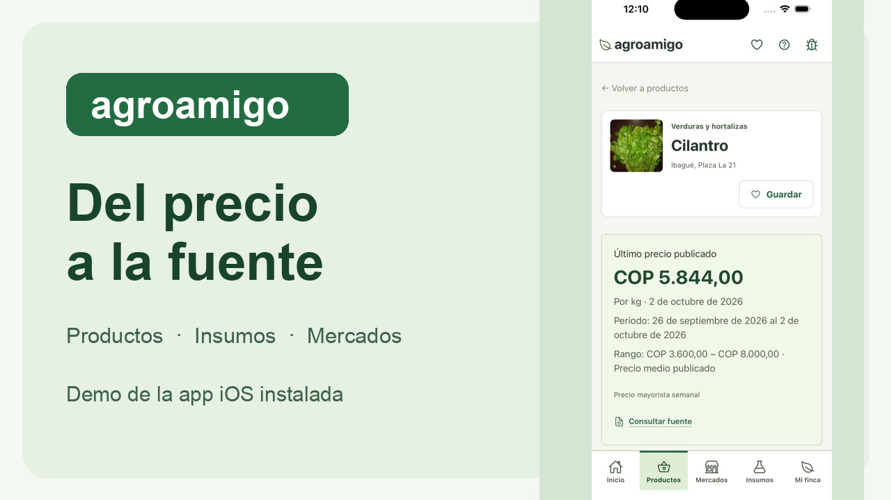

# AgroAmigo

AgroAmigo is a Spanish-language application for Colombian farmers and purchasers. It brings together agricultural prices, market arrivals, input comparisons, local weather and territorial references, with links to the original sources.

The web interface is shared by Android and iOS clients. The five main sections are **Inicio, Productos, Mercados, Insumos and Mi finca**.

- **Products and markets:** dated prices, original units, filters, retained history and comparable market quotations.
- **Inputs:** commercial identities, presentations and department or municipality prices.
- **Supply:** reported arrivals by food, destination market and month, with reporting coverage.
- **Mi finca:** a saved location, weather, territorial layers and read-only crop, calendar, cost-study and price-history references.
- **Coffee and offers:** FNC reference conversions and private offer comparisons, kept separate from official market data.
- **Sources:** PDF, spreadsheet and structured-data viewers with original downloads and provenance.
- **Problem reports:** describe a data or app issue with its screen and source context, and optionally provide a reply email.

Demo: [web application](https://agroamigo-demo-9a04.azurewebsites.net) · [Android installation](https://agroamigo-demo-9a04.azurewebsites.net/android).

## See AgroAmigo in action

A 97-second walkthrough recorded in the installed iOS app: find a product, inspect its dated price, open the original DANE PDF, compare input presentations and consult the read-only Excel workbook. The tour also compares Corabastos with the national average and expands the category differences.

[](docs/media/agroamigo-walkthrough.mp4)

[Watch the 97-second walkthrough (MP4)](docs/media/agroamigo-walkthrough.mp4).

| Time | What you can do |
|---|---|
| 0:03 | Find Cilantro in the product catalog |
| 0:19 | Inspect its weekly price, reporting period and market |
| 0:31 | View page 14 of its original DANE weekly PDF |
| 0:36 | Find Wuxal Tapa Negra and compare the same presentation |
| 1:07 | Open its original Excel workbook inside the app |
| 1:23 | Compare Corabastos with Colombia and expand category differences |

Recorded on October 7, 2026, using public source data. Prices and coverage may change as new reports are published.

## Repository

| Directory | Purpose |
|---|---|
| [apps/web](apps/web) | Next.js interface, APIs and server-side queries |
| [apps/android](apps/android/README.md) | Android WebView client |
| [apps/ios](apps/ios/README.md) | Flutter client using WKWebView |
| [pipelines](pipelines/README.md) | Source discovery, importers and recurring ingestion |
| [infra](infra/README.md) | Azure provisioning and deployment implementation |

See the [app site map](docs/SITE_MAP.md), [architecture](docs/ARCHITECTURE.md), [code navigation](docs/CODE_NAVIGATION.md), [data sources](docs/DATA_SOURCES.md) and [Mi finca](docs/MI_FINCA_DATA.md).

## Local web setup

Install Node.js with npm. From the repository root:

```sh
npm ci
npm run dev
```

Database-backed pages require a server-side `DATABASE_URL`, normally provided through the ignored `apps/web/.env.local`. Use an appropriately restricted PostgreSQL account. Certificate validation is enabled by default. Credentials are not sent to the browser.

`npm run build` creates the production web build. Mobile setup is described in each client's README. The app requires network access for source data; locally saved farms, favorites and offers do not provide an offline copy of official prices.
