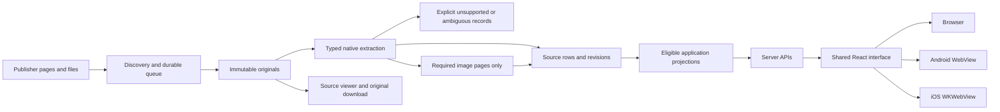

# Application and data architecture

AgroAmigo has a Next.js application and two mobile clients that load the same interface. Android uses WebView; the Flutter iOS client uses WKWebView. Product behavior and data queries live in the shared web application. Native shells provide navigation, location permissions, downloads, sharing and connection recovery.

The [app site map](SITE_MAP.md) shows navigation between screens, source viewers and secondary routes.

## Application flow

| Section | Routes | Behavior |
|---|---|---|
| Inicio | `/` | Search and entry points into the catalog and local references |
| Productos | `/products`, `/product/[id]`, `/references/[id]` | Canonical products and official quote identities, dated prices, history and sources |
| Mercados | `/markets`, `/market/[id]` | Market quotations and reported supply |
| Insumos | `/insumos`, `/insumo/[id]` | Commercial input identities and comparable presentations |
| Mi finca | `/farm`, `/farm/[id]`, `/plan` | Location, weather, territorial context and read-only crop references |

`/saved` holds favorites, `/offers` compares privately entered offers, `/sources` explains data and methods, and `/credits` attributes images. `/evidence/[id]` provides a direct source view; the same viewer can open over a detail page. `/reportar` accepts an optional Spanish bug report through a consent-based form available from help links. The form submits only its text, optional reply email and a sanitized internal page/source reference. The server queues delivery to the owner and reports the queued state separately from actual mail delivery; it never attaches device-local farms, offers or precise GPS coordinates.

Mi finca has no manual profitability or crop-budget editor. Legacy budget links open published references, and earlier farm/scenario data remains stored. The useful FNC quantity conversion and offer calculations remain separate features.

## From an official source to a screen

Source bytes are identified by SHA-256 and retained in PostgreSQL and private Azure Blob Storage. Changed bytes at the same URL create a new original. Parsed observations retain document, sheet/page/row, original unit and reporting period. A generated extract is labelled as derived and links to its original.

For DANE city ZIPs, a changed body is retained as a candidate alongside the accepted original and its PDF members. The worker validates the complete candidate cohort before moving the source's current publication head; incomplete or rejected candidates remain available for review without replacing the accepted observations. This source-specific process is part of the normal worker path, not a manual repair or a rewrite of the old archive.

Native parsing precedes OCR. Only supported failed layouts can publish through a typed OCR adapter, with independent readings and source-specific validation. Retaining an image or extracted text does not imply that its prices have been published. Missing dates, conflicting identities and unsupported units remain reviewable.

Historical observations are retained. Published views apply source review, parser revision and date eligibility rules. Canonical prices, package quotations, weekly means, milk farmgate prices and international benchmarks keep their distinct units and bases. Published supply summaries retain their own reporting periods and precision; they are not added to food-level arrivals. The frontend uses bounded queries, caches and current read models rather than rebuilding every history on each request. Input catalogs combine a complete location index with changes committed since that index was built. A replacement index is prepared alongside the readable one and swapped atomically; if index coverage is unavailable, readers use the published observations directly.

A shared, versioned dictionary standardizes reviewed product, category and place labels across ingestion and app displays. Scheduled publication scans existing product metadata with a durable cursor and records each correction with its original label and dictionary hash. Comparisons apply display cleanup after selecting source observations and calculating differences; equivalent category spellings share one summary and their filters include every stored variant. Commercial input names receive Unicode and whitespace cleanup. Varieties, formulations, identities, units, prices and original documents retain their source meaning; unknown spellings require source evidence before a correction is added.

## Server and storage boundaries

`apps/web/src/lib/server` owns database access and server-only queries. APIs validate their filters and use parameterized SQL. The web role reads published data and can retain public weather/spatial responses; ingestion uses a separate restricted writer. Credentials stay on the server.

| Store | Responsibility |
|---|---|
| `source_document` and source relationships | Immutable originals, derived evidence and parentage |
| `historical_price` and source-specific raw tables | Source observations and parser revisions |
| Price, input and supply projections | Eligible data for the application |
| `official_price_quote` / `official_catalog_current` | Distinct reference identities and a small current catalog |
| Ingestion queue and checkpoints | Retry, bounded execution and durable resume |
| Weather and spatial snapshots | Public model/geographic responses with query provenance |
| Bug-report outbox | Consent-based reports awaiting bounded email delivery or retry; unrelated to source ingestion |

## Location and private data

Farm locations, saved products and private offers are stored on the device. Browser, Android and iOS storage are separate. There is no account-based synchronization of these records. Existing farm and scenario storage is preserved when using the read-only reference views.

A saved farm pin is distinct from an explored map point or municipal reference center. Forecast and spatial requests send the selected coordinates to the server and relevant public provider; their responses are retained for provenance. Regional maps and municipal soil summaries do not establish parcel conditions.

## Execution and delivery

Azure Functions performs recurring discovery, recent refreshes, historical backfill and bounded OCR recovery. A shared advisory lock prevents overlapping writers; checkpoints allow interrupted work to resume. Timer schedules and execution budgets are configured separately from source adapters.

Sources are validated before publication. Catalog refreshes commit small groups of identities, and a source is marked complete only after every group finishes. Corrected identities remain unavailable while their derived rows need refresh; original observations and source files are retained. Historical app queries also use bounded reads so scheduled imports can run alongside browsing. Database date cutoffs use Colombia's timezone.

Worker deployments acquire that same lock before changing settings or restarting the function host. An active ingestion run blocks deployment until its committed work finishes; deployment failures release the lock. Original archives and price history remain independent of runtime deployments.

The Azure web deployment packages the Next.js standalone server and local viewer/map assets. Mobile packages contain the native shells and load the hosted application. The iOS workflow builds the client and supports signed TestFlight delivery. Shared interface changes and native-shell changes therefore have separate delivery paths.

The daily bulletin route stores its selected date, product and market in URL query parameters. Changing one filter keeps the other applied choices in the address, so the selected bulletin view can be revisited or shared.

The independent Spanish news collector is runnable locally but is not connected to a cloud news scheduler or public app feed. Its editorial records are separate from agricultural price observations.

See [code navigation](CODE_NAVIGATION.md), [ingestion](../pipelines/ingestion/README.md), [infrastructure](../infra/README.md) and [data sources](DATA_SOURCES.md).
