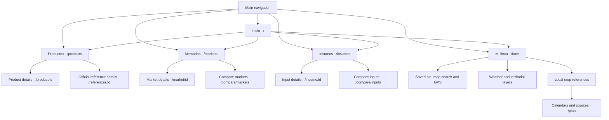
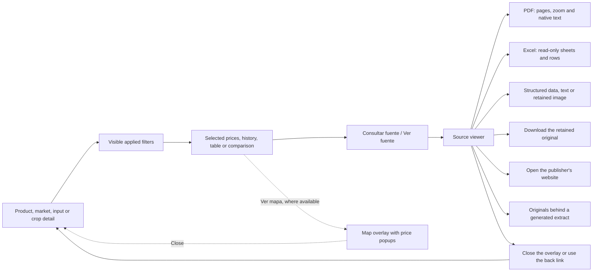

# App site map

AgroAmigo uses the same screens and routes on the web, Android and iOS. The five main sections appear in the desktop sidebar and mobile bottom navigation. The header also opens **Mis guardados** and **Fuentes y ayuda**.

## Main navigation

The product catalog brings together the available products and official references. A card opens the appropriate detail screen, where its source, reporting period, currency and units are explained. `id` in the diagram represents the identifier in a real URL, such as `/product/aguacate-hass`.

## Checking a value and returning to the screen

Source links can open an overlay over the current screen or a direct `/evidence/[id]` page. Closing an overlay returns to the underlying selection. A direct evidence page links to **Fuentes y ayuda**. PDF page and Excel sheet/row links open the corresponding part of the retained file. The viewer identifies generated extracts and links to their parent originals.

Filters such as market, region, presentation, units and history period belong to the selected data view. The app displays the applied selection beside the relevant data. Map popups and comparison screens keep their own visible scope. On mobile, the five bottom tabs remain available on source and image-credit pages.

## Route directory

| Screen | Route | Entry point and purpose |
|---|---|---|
| Inicio | `/` | Main tab; entry cards, search and featured products |
| Productos | `/products` | Main tab; unified searchable product catalog |
| Product details | `/product/[id]` | Product card; selected price, history, source, supply and available comparisons |
| Official reference details | `/references/[id]` | Reference card; publisher-specific price identity and history |
| Mercados | `/markets` | Main tab; market list and comparison shortcut |
| Market details | `/market/[id]` | Market card; expandable quotations and reported supply |
| Market comparison | `/compare/markets` | Mercados; matching product/presentation/unit comparisons, including Colombia average |
| Insumos | `/insumos` | Main tab; commercial input identities and geographic filters |
| Input details | `/insumo/[id]` | Input card; presentation-specific price, history, comparison and source |
| Input comparison | `/compare/inputs` | Insumos; compare matching input presentations by place |
| Mi finca | `/farm` | Main tab; choose or save a specific location, inspect weather, layers and crop references |
| Saved farm context | `/farm/[id]` | Opens Mi finca using a farm stored on that device |
| Crop references | `/plan` | Crop's **Ver calendario y fuentes** action; municipality and crop selection, calendars and published studies |
| Mis guardados | `/saved` | Heart icon in the header or desktop sidebar; saved products |
| Fuentes y ayuda | `/sources` | Help icon, sidebar and footer; data explanations, official links and installation help |
| Source viewer | `/evidence/[id]` | **Consultar fuente / Ver fuente**; retained original, provenance and downloads |
| Image credits | `/credits` | Fuentes y ayuda or footer; image origin, author and license |
| Android installation | `/android` | Fuentes y ayuda or README; installation instructions |
| Additional official-price index | `/references` | Fuentes y ayuda; filter official references by publisher, category and currency |
| City-report index | `/regional` | Direct secondary route; city package quotations, with a return link to Productos |
| Daily-price index | `/daily` | Direct secondary route; daily product/market filters and an offer-comparison link |
| Published summaries | `/data-references` | Secondary source-summary view; input, electricity and monthly wholesale references |
| Private offer comparison | `/offers` | Daily-price view or direct link; offers entered on the current device |

Source viewers, maps, filters and expandable price lists are often panels within these screens; they do not each create a separate route. Farm names, saved pins, favorites and private offers are device-local. Selecting a municipal reference or exploring a map point does not by itself confirm a new saved farm pin.

## Compatibility redirects

| Previous/direct route | Destination |
|---|---|
| `/coffee` | `/product/cafe-pergamino-seco` |
| `/map` | `/markets`; open a map from an available **Ver mapa** action |
| `/auth` | `/saved` |
| `/settings` | `/sources` |

See [architecture](ARCHITECTURE.md) for data flow and [code navigation](CODE_NAVIGATION.md) for the files implementing these screens. The route directory corresponds to the current [Next.js pages](../apps/web/src/app) and [shared navigation](../apps/web/src/app/app-shell.tsx).
