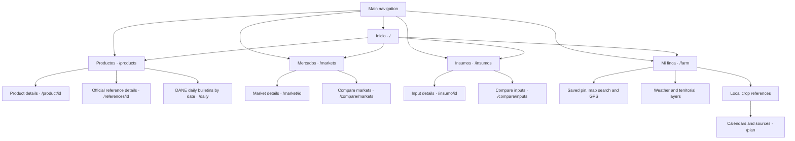
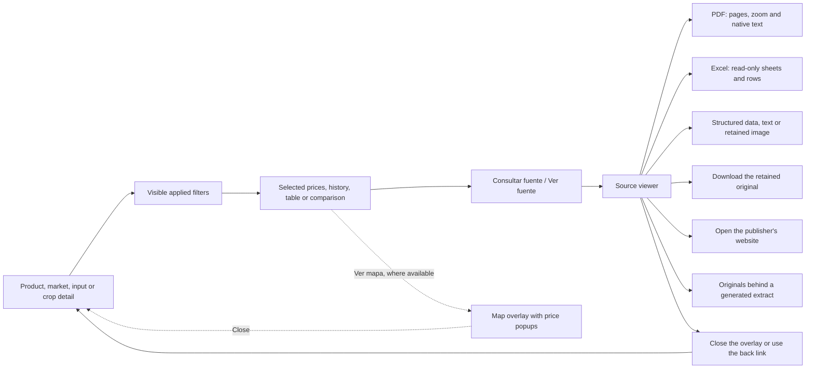

# App site map

AgroAmigo uses the same screens and routes on the web, Android and iOS. The five main sections appear in the desktop sidebar and mobile bottom navigation. The header also opens **Mis guardados**, **Fuentes y ayuda**, and **Reportar un problema**.

## Main navigation

The product catalog brings together the available products and official references. A card opens the appropriate detail screen, where its source, reporting period, currency and units are explained. Products with both monthly averages and city reports let you choose **Tipo de precio → Informe por ciudad · diario**, then the market, presentation and units. City package prices use the last available round for each market and date; their source action opens the original PDF from the retained ZIP. `id` in the diagram represents the identifier in a real URL, such as `/product/aguacate-hass`.
Category filters show searchable parent groups and indented subgroups only when a selected published record carries an explicit classification path. A parent includes its source-supported children; unrelated flat categories remain separate. The selected full category path stays visible beside the other applied filters.

All search bars and searchable dropdowns ignore case and accents when matching: `CÍTRICOS`, `citricos` and a decomposed accented spelling reach the same choice. Displayed names retain their source-supported spelling. This also applies to document-library searches, DANE summary record searches and place searches. Choosing a map from the product catalog carries its category, department and history scope; choosing another map product retains those filters while resolving its compatible price series and package.

## Checking a value and returning to the screen

Source links can open an overlay over the current screen or a direct `/evidence/[id]` page. Closing an overlay returns to the underlying selection. A direct evidence page links to **Fuentes y ayuda**. PDF page and Excel sheet/row/column links open the corresponding part of the retained file; a cited Excel cell is highlighted. The viewer identifies generated extracts and links to their parent originals.

The supply map shows the latest reporting month available for the selected product and department, in kilograms. The reporting month remains visible; each market also shows its last reported day. Its source link opens the retained file for that market and month. When several originals contribute to a total, a searchable file selector lets the user inspect each one. Within a workbook, **Filas originales de abastecimiento** searches every contributing row or row interval and shows the selected sheet and interval. Opening a row preserves the product, market, reporting month and kilograms; the workbook stays read-only.

**Reportar un problema** opens `/reportar` from the header, desktop sidebar, footer or direct source page. The internal page path and safe data filters provide context; precise coordinates and device-local data are omitted. The reporter writes a description, may supply a reply email, and consents to share it with the owner. Confirmation means the report was queued for delivery, not that an email was already sent. The five mobile bottom tabs remain available.

Long selection lists use searchable dropdowns on all three platforms: municipalities, saved farms, markets, products, commercial input lines, presentations, units, reporting periods, PDF pages and Excel sheets. Search ignores letter case and treats accented and unaccented letters equivalently, including decomposed Unicode accents, and shows up to eight suggestions; typing or clearing the search text does not change the applied choice. Selecting a result applies it, and the current selection remains visible. Optional filters have **Quitar selección**; required choices can be replaced by another result. The document library uses the same bounded search to open retained originals. Daily bulletins ask for an exact product before showing its prices by plaza, so the full bulletin does not become a long scrolling card list. The product overview shows at most six prices; the plaza dropdown reaches any remaining market. Product and coffee details keep six ranked markets or delivery points visible; the comparison dropdown finds any other location and shows its price, date and original source beside that summary. When a product has more than six additional price references, **Consultar otra referencia y fuente** opens a searchable choice and displays only the selected reference card. Each option identifies its publisher, reporting period, currency and unit; the card opens that reference's own details and original source. Insumo comparison and coverage search all available locations, retaining the selected location and its own price source. Market price lists and product comparison cards retain six overview entries and an exact searchable combination, rather than expanding every result at once. Historical averages and market-comparison averages search individual source records by location, date and units. Long history tables show twelve rows in the chosen order plus the selected record; their date search reaches the full filtered history without changing the graph. The selected price has its own source action beside the selection, so its original can be opened without scrolling through the table. When that date averages multiple source records, the action offers those contributing originals instead of choosing one arbitrarily. Supply charts show twelve recent months plus the chosen historical month, with all months reachable through search; detailed arrivals retain a short overview and a searchable report selector. Map price popups use the same bounded overview and search. Mi finca asks for an exact crop when the municipal crop list is long, keeping that crop's calendar and sources available.

Filters such as market, region, presentation, units and history period belong to the selected data view. The app displays the applied selection beside the relevant data. Map popups and comparison screens keep their own visible scope. On mobile, the five bottom tabs remain available on source and image-credit pages.

## Route directory

| Screen | Route | Entry point and purpose |
|---|---|---|
| Inicio | `/` | Main tab; entry cards, search and featured products |
| Productos | `/products` | Main tab; unified searchable product catalog |
| Product details | `/product/[id]` | Product card; selected price, history, source, supply and available comparisons |
| Official reference details | `/references/[id]` | Reference card; publisher-specific price identity and history |
| Mercados | `/markets` | Main tab; market list and comparison shortcut |
| Market details | `/market/[id]` | Market card; expandable quotations and reported supply |
| Market comparison | `/compare/markets` | Mercados; matching product/presentation/unit comparisons, including Colombia average |
| Insumos | `/insumos` | Main tab; commercial input identities and geographic filters |
| Input details | `/insumo/[id]` | Input card; presentation-specific price, history, comparison and source |
| Input comparison | `/compare/inputs` | Insumos; compare matching input presentations by place |
| Mi finca | `/farm` | Main tab; choose or save a specific location, inspect weather, layers and crop references |
| Saved farm context | `/farm/[id]` | Opens Mi finca using a farm stored on that device |
| Crop references | `/plan` | Crop's **Ver calendario y fuentes** action; municipality and crop selection, calendars and published studies |
| Mis guardados | `/saved` | Heart icon in the header or desktop sidebar; saved products |
| Fuentes y ayuda | `/sources` | Help icon, sidebar and footer; data explanations, official links and installation help |
| Reportar un problema | `/reportar` | Help link or source page; consent-based Spanish report with optional reply email and safe page/source context |
| Source viewer | `/evidence/[id]` | **Consultar fuente / Ver fuente**; retained original, provenance and downloads |
| Image credits | `/credits` | Fuentes y ayuda or footer; image origin, author and license |
| Android installation | `/android` | Fuentes y ayuda or README; installation instructions |
| Additional official-price index | `/references` | Fuentes y ayuda; filter official references by publisher, category and currency |
| City-report index | `/regional` | Direct secondary route; city package quotations, with a return link to Productos |
| DANE daily bulletins | `/daily` | Productos link; date, product and market filters are reflected in URL query parameters; inspect original Excel cells and compare offers |
| Published summaries | `/data-references` | Secondary source-summary view; input, electricity and monthly wholesale references |
| Private offer comparison | `/offers` | Daily-price view or direct link; offers entered on the current device |

Source viewers, maps, filters and expandable price lists are often panels within these screens; they do not each create a separate route. The image-credit page searches by image, product, author or license and shows the selected image with its attribution and original links. Farm names, saved pins, favorites and private offers are device-local. Selecting a municipal reference or exploring a map point does not by itself confirm a new saved farm pin.

## Compatibility redirects

| Previous/direct route | Destination |
|---|---|
| `/coffee` | `/product/cafe-pergamino-seco` |
| `/map` | `/markets`; open a map from an available **Ver mapa** action |
| `/auth` | `/saved` |
| `/settings` | `/sources` |

See [architecture](ARCHITECTURE.md) for data flow and [code navigation](CODE_NAVIGATION.md) for the files implementing these screens. The route directory corresponds to the current [Next.js pages](../apps/web/src/app) and [shared navigation](../apps/web/src/app/app-shell.tsx).
